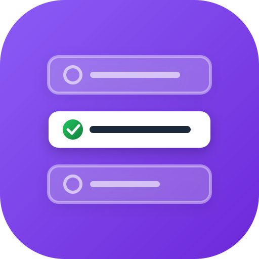
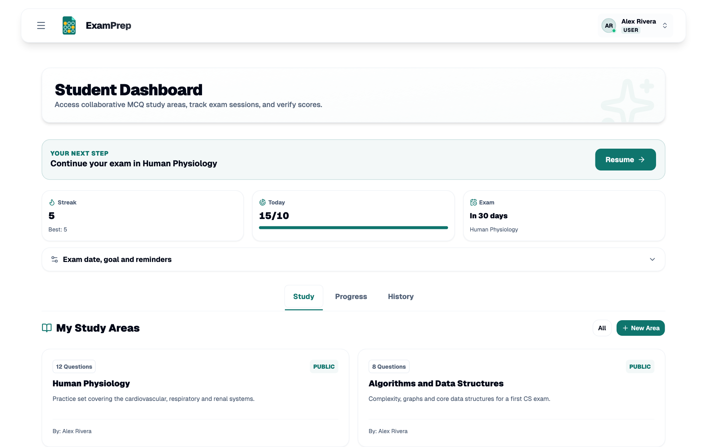
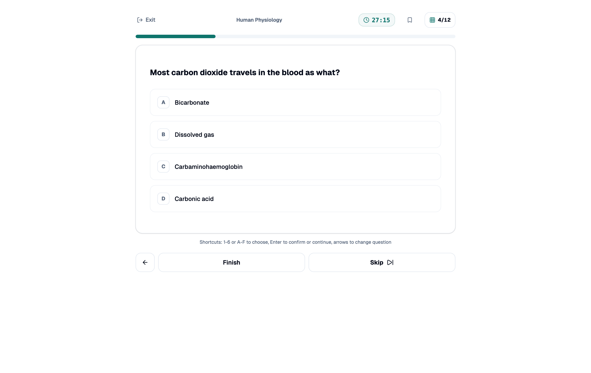
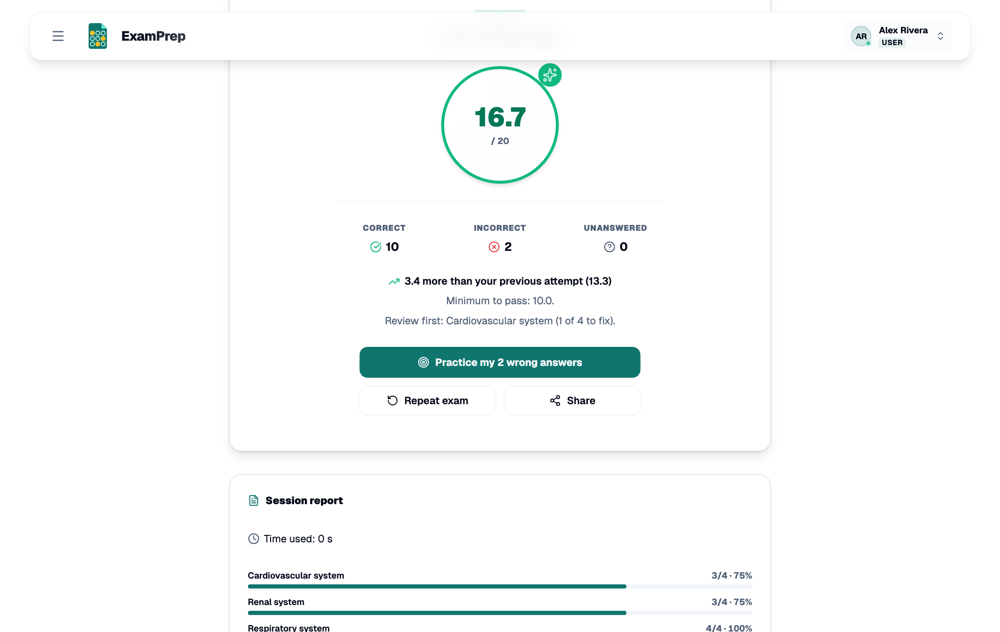
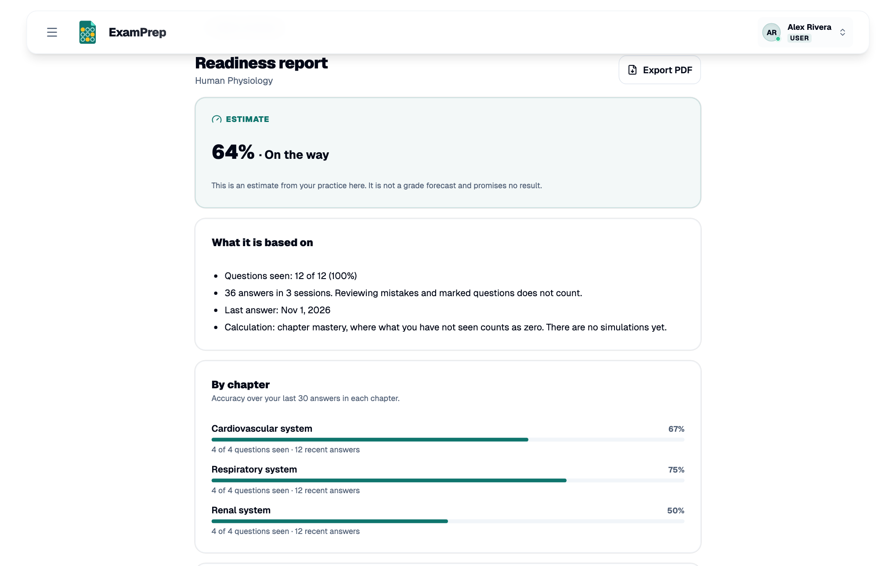

<p align="center"></p>

<h1 align="center">ExamPrep</h1>

<p align="center">
Rereading your notes feels like studying. Answering questions and getting them wrong actually is.<br>
ExamPrep turns a question bank into timed mock exams, graded from 0 to 20, that show you what to fix next.
</p>

<p align="center">
<a href="https://escolhamultipla.pt"><strong>Try it without installing</strong></a> ·
<a href="docs/self-hosting.md">Host your own</a> ·
<a href="docs/writing-questions.md">Write questions</a>
</p>



## Who this is for

A teacher who wants one place for a class's question banks. A study group sharing a set before finals. A school that can't send student data to someone else's servers. You can run all of it on a small server you control, with every feature switched on and no accounts on our side.

If you'd rather just study, the same app runs at **[escolhamultipla.pt](https://escolhamultipla.pt)**, with nothing to set up. The name and logo of that hosted site aren't part of this project or its licence.

## What happens in one study session

**1. You build a study area.** Type questions in the editor, import a JSON file, or, if you connect an AI provider, generate a draft from a PDF. Questions sit in chapters, and each has two to six options and an optional explanation.

**2. You sit an exam on your terms.** Pick the chapters and how many questions from each, then set a time limit, a passing score and a penalty for wrong answers. You can also choose whether to see the answer straight away and whether going back is allowed. Your answers are saved one at a time, so a dropped connection doesn't lose the exam.



**3. You find out what to fix.** The result names the weakest chapter and offers to re-run only the questions you got wrong.



**4. You see how close you are.** The readiness report counts unseen questions as zero and says so, because a percentage built only on what you've practised flatters you. It doesn't predict a grade. Set an exam date and the dashboard turns the remaining work into a daily plan.



## Start it in three commands

You need Docker with Compose. Fill in the four required values in `.env`, which is explained in the [self-hosting guide](docs/self-hosting.md).

```bash
git clone https://github.com/devMotcho/ExamPrep-OSS.git && cd ExamPrep-OSS
cp .env.example .env
docker compose up -d --build
```

The app is then at <http://localhost:8080>. Sign in with the admin account you set in `.env`.

The first build compiles the backend and frontend, so expect a few minutes.

## What you get, and what you don't

| Included | Details |
|---|---|
| Exam engine | 0–20 grading, timers, penalties, chapter selection, saved setups, resuming, retrying wrong answers |
| Study tools | Streaks, daily goals, exam-date countdown, marks and notes on questions, PDF reports |
| Sharing | Public and private study areas, shared by link |
| Administration | Users, contact inbox, blog, colours, name and logo, all from the browser |
| Languages and devices | English and Portuguese, light and dark, installable as a PWA |
| Optional services | Email (SMTP), images (S3, MinIO, R2), Google and Microsoft sign-in, AI generation (Anthropic or OpenAI, your key) |

**Not included:** payments, subscriptions, or any limit on what a user can do. On your instance everyone gets everything. There are also no terms of service or privacy policy pages: if you open your instance to the public, those are yours to write, and the [hosting guide](docs/self-hosting.md#before-you-open-registration) lists what to think about.

## How it's built

Java 21 and Spring Boot 3 with PostgreSQL behind a React 18 and Vite front end. nginx serves the app and forwards `/api` to the backend. The [architecture notes](docs/architecture.md) say where things live and explain the two decisions most likely to surprise you.

## Documentation

- [Self-hosting](docs/self-hosting.md): install, HTTPS, backups, updates
- [Configuration](docs/configuration.md): every environment variable
- [Writing questions](docs/writing-questions.md): the editor, the JSON format, AI generation
- [Architecture](docs/architecture.md): how the code is organised
- [Contributing](CONTRIBUTING.md) and [security reports](SECURITY.md)

## Licence

[AGPL-3.0](LICENSE). Use it, change it, charge for it. If you offer a modified version to others over a network, you must share your changes with them.
