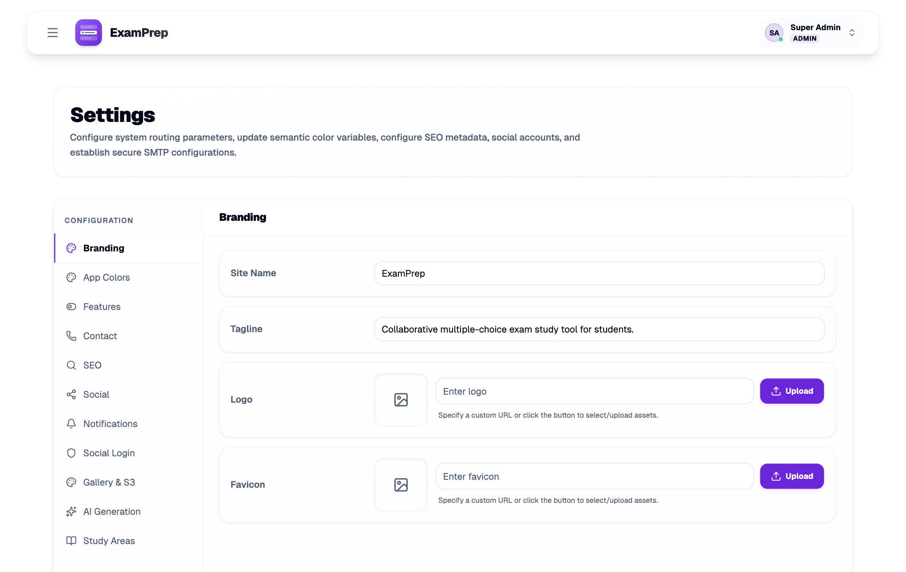

# Self-hosting

This guide takes you from nothing to a running instance, then to one that's safe to share. Don't want to run a server? [escolhamultipla.pt](https://escolhamultipla.pt) is the hosted version of the same app.


## What you need

- Docker with Compose v2
- 2 GB of RAM (the backend is a JVM, and the first build needs the headroom)
- A domain and a reverse proxy, if anyone but you will use it

## Install

```bash
git clone https://github.com/devMotcho/ExamPrep-OSS.git
cd ExamPrep-OSS
cp .env.example .env
```

Fill in the required values in `.env`:

| Variable | How to get it |
|---|---|
| `POSTGRES_PASSWORD` | `openssl rand -base64 24` |
| `JWT_SECRET` | `openssl rand -base64 48` (the app refuses to start under 32 bytes) |
| `DEFAULT_ADMIN_EMAIL` | Your email |
| `DEFAULT_ADMIN_PASSWORD` | 12 characters or more. Weak values are rejected and no admin is created |

Then start it:

```bash
docker compose up -d --build
docker compose logs -f backend
```

When the log says `Started Application`, open <http://localhost:8080> and sign in.

The admin account is only created when it doesn't exist yet. Changing the password in `.env` later has no effect, so change it inside the app.

## Make it yours

Open **Settings** as admin. The name, tagline, logo, favicon and colours all take effect without a rebuild, and each feature can be switched on or off there.



## Put it behind HTTPS

Run a reverse proxy in front of port 8080. With Caddy:

```
exam.example.org {
    reverse_proxy localhost:8080
}
```

Then update `.env` and restart:

```bash
PUBLIC_URL=https://exam.example.org
COOKIE_SECURE=true
```

```bash
docker compose up -d
```

Forgetting `PUBLIC_URL` breaks links in emails and social sign-in. Bind the published port to your proxy only (`127.0.0.1:8080:8080` in `docker-compose.yml`), so nobody can reach the app around it.

The web container keeps the `X-Forwarded-Proto` your proxy sends, so secure cookies and social sign-in work behind it. Caddy, nginx and Traefik set that header by default.

### Security headers

The web container sends a Content-Security-Policy, `X-Content-Type-Options`, `Referrer-Policy` and `Permissions-Policy` on every response, and refuses to be framed. Two things depend on your setup:

- **Strict-Transport-Security** is off until you turn it on, because a browser that has seen it refuses plain HTTP for that host until it expires. Once HTTPS works, set `HSTS_HEADER_VALUE=max-age=31536000` in `.env`. It is only sent on requests that arrived over HTTPS.
- **Images and videos** may load from any `https:` address, which covers S3, R2 and most other hosts. An S3-compatible server on plain HTTP, such as MinIO on a local network, must be added: `CSP_EXTRA_MEDIA_SOURCES=http://minio.local:9000`. Separate several addresses with spaces.

If you change the inline script in `frontend/index.html`, update its hash in `infra/nginx.conf`. A frontend test fails until the two match.

## Upgrading

Upgrading to this version signs everyone out once, as stored refresh tokens are replaced by hashes, and removes confirmation codes in progress. The web container now listens on port 8080 inside the container: if you changed the port mapping in `docker-compose.yml`, change its right-hand side from `80` to `8080`.

S3 and SMTP secrets set in the environment are removed from the database on startup. Secrets you entered in the settings are encrypted on startup when `AI_SETTINGS_ENCRYPTION_KEY` is set.

New password registrations are only marked confirmed when `confirmation_code_enabled` is on. Accounts that already exist keep their state. See [architecture](architecture.md#authentication).

`GET /api/api/study-areas` now returns one page of summaries (`page`, `size`, `q`) instead of a full list, and `POST /api/auth/send-code` needs a `purpose`. Scripts using the API must follow. `Authorization: Bearer` is no longer accepted.

## Before you open registration

Anyone who registers can create study areas and upload files. For a public instance:

- Review `MAX_UPLOAD_MB`, `MAX_UPLOADS_PER_DAY` and `MAX_STUDY_AREAS_PER_USER` ([configuration](configuration.md)).
- Turn registration off in **Settings → Features** if it's only for your class, and add users yourself.
- Configure SMTP, otherwise password reset can't work.
- Write your own terms and privacy policy. ExamPrep ships none, because what they must say depends on who you are and where you operate. You are responsible for your users' data.
- Review the cookie notice text against the services you enable.

## Backups

All state is in PostgreSQL, plus images if you use S3.

```bash
docker compose exec -T db sh -c 'pg_dump -U "$POSTGRES_USER" "$POSTGRES_DB"' > examprep-$(date +%F).sql
```

To restore, into an empty database:

```bash
docker compose exec -T db sh -c 'psql -U "$POSTGRES_USER" "$POSTGRES_DB"' < examprep-2026-01-31.sql
```

Test a restore before you need one.

## Updates

```bash
git pull
docker compose up -d --build
```

Database migrations run on startup. Take a backup first.

## When something goes wrong

| Symptom | Likely cause |
|---|---|
| Backend exits with `JWT_SECRET must be set` | Missing or shorter than 32 bytes |
| Can't sign in as admin | Password under 12 characters or weak: check `docker compose logs backend \| grep -i admin` |
| Signed out right after signing in | `COOKIE_SECURE=true` on plain HTTP |
| Image upload returns 503 | No S3 storage configured |
| Social sign-in redirects to the wrong host | `PUBLIC_URL` isn't your public address |
| No reminder or reset emails | SMTP not configured, or `SMTP_FROM` isn't a valid address |
