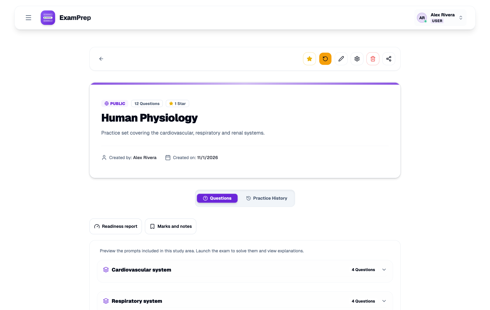

# Writing questions

A question bank is only as good as its explanations: a wrong answer is the moment a student reads them. You can see the result of a good bank on [escolhamultipla.pt](https://escolhamultipla.pt) without installing anything.



## Three ways in

**The editor.** Open a study area, add a question, and choose the correct option. Best for a handful of questions, or for adding an image.

**A JSON file.** Best for anything longer. Upload it from the study area's edit page.

**AI generation.** Upload a PDF and review a draft before it's saved. An admin must enable it first.

## The JSON format

The file is an array of questions. Chapters are created from the names you use.

```json
[
  {
    "prompt": "Where does gas exchange primarily occur?",
    "explanation": "Oxygen and carbon dioxide diffuse across the alveolar membrane.",
    "chapter": "Respiratory system",
    "options": [
      { "text": "Alveoli", "correct": true },
      { "text": "Trachea", "correct": false },
      { "text": "Bronchi", "correct": false },
      { "text": "Pleura", "correct": false }
    ]
  }
]
```

| Field | Rule |
|---|---|
| `prompt` | Required |
| `options` | 2 to 6, with exactly one `correct: true` |
| `explanation` | Optional, but write it |
| `chapter` | Optional |

## Turning on AI generation

1. Set `AI_SETTINGS_ENCRYPTION_KEY` in `.env` (`openssl rand -base64 32`) and restart. It encrypts the provider key in the database. Keep it safe, since losing it means entering the provider key again.
2. In **Settings → AI Generation**, choose Anthropic or OpenAI, paste your API key, choose a model, and use the test button.
3. Set the monthly spend cap, the hourly rate limit and the per-user quota. Every generation costs you money, and the PDF is sent to the provider you chose.

AI drafts can be wrong. Students should never see one that nobody has read.

## Writing questions that teach

- Test one idea per question.
- Make wrong options plausible: use real misconceptions, not jokes.
- Avoid "all of the above"; it rewards pattern-matching.
- Explain why the right answer is right, and if useful why the tempting one isn't.
